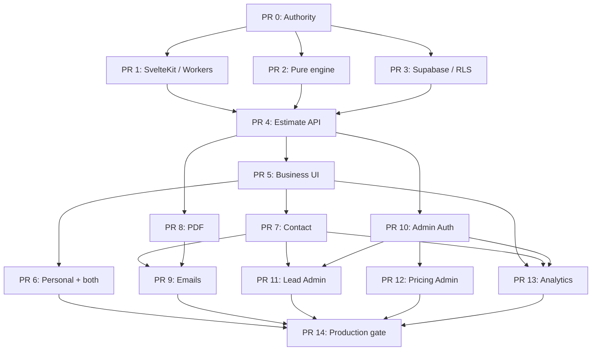

# Goat Accounting Estimator — Parallel Execution Roadmap

**Revision:** 0.1.1 
**Date:** 2026-11-03 
**Status:** Approved scheduling amendment; **Product/Tech specs remain unchanged at v0.1.0** 
**Repository:** `JCSchoeman96/goat_accounting` 
**Authority:** `docs/product/goat-accounting-estimator-product-spec-v0.1.0.md`, `docs/architecture/goat-accounting-estimator-tech-spec-v0.1.0.md`, `docs/superpowers/plans/2026-11-03-goat-accounting-estimator.md`.

## Decision

Run up to **three isolated coding worktrees concurrently**, only after shared PR 0 authority has merged. **Waves are staffing suggestions, not fixed barriers:** schedule any task whose own listed dependencies are merged, even if an unrelated earlier-wave task is still active. Only the explicit fan-in gates block dependent work. Parallelism permits early development, never bypasses independent diff/CI/spec review, dependency sequencing, staging validation or production release controls. **Keep the existing PR 0–14 numbering**, regardless of the chronological wave in which a task executes.

## Execution waves

| Gate / wave | Concurrent agent slots | Preconditions | Merge/exit evidence |
|---|---|---|---|
| Gate 0 | PR 0, serial | accepted Product/Tech v0.1.0 | docs exact-byte check, `AGENTS.md` fixed, review/CI, merged |
| Wave 1 | A: PR 1 runtime; B: PR 2 pure domain; C: PR 3 Supabase schema | Gate 0 merged; PR 3 remote DDL additionally needs positively identified Goat staging project | review each diff/CI; integrate all three with rebases; regression and API/schema reconciliation |
| Gate 1–2 | PR 4, serial | PR 1+2+3 **merged** | end-to-end Worker + authoritative calculation + transactional saved immutable result |
| Wave 2 | A: PR 5 business UX; B: PR 8 PDF; C: PR 10 admin auth | PR 4 merged (and PR 1/3 for Auth) | UI, Worker PDF, MFA/RLS proven; dependency lockfile integrations serialised |
| Wave 3 | A: PR 6 personal/both; B: PR 7 contact/Turnstile; C: PR 12 pricing admin | PR 5 for PR 6/7; PR 10 and domain/DB for PR 12 | branching, durable lead, atomic activation and old-price stability |
| Wave 4 | A: PR 9 emails; B: PR 11 lead management; C: PR 13 analytics/dashboard | PR 7+8 for PR 9; PR 7+10 for PR 11; PR 5+7+10 for PR 13 | saved snapshot consistency, event audit, no PII analytics |
| Gate 5–launch | PR 14, serial | PR 0–13 merged + proven staging | calibrated prices/owner approval, full security/a11y/E2E, controlled production release |

## DAG

**Dynamic scheduling:** PR 6/7 can start when PR 5 merges even if PR 8 is not finished; PR 12 can start when PR 10 merges, even if PR 5 is not finished; PR 11/13 can start as soon as their own dependencies merge. Maintain at most three concurrent agents and serialise merging/rebases.

**DAG shorthand:** PR 12 also requires the already merged PR 2/3/4, as all Wave 2 tasks do. PR 14 requires **all** PR 0–13, including PR 5/7/8/10. The diagram shows only sufficient dependency edges to preserve clarity; the table and master plan are authoritative for exact gate conditions.

## Ownership and integration policy

| Lane | First wave files | Must NOT touch while in parallel |
|---|---|---|
| A — runtime | `package.json`, `bun.lock`, `vite.config.*`, `wrangler.toml`, `tsconfig.json`, `src/app.d.ts`, existing runtime env adapters | `src/lib/domain/estimator/**`, `src/lib/domain/pricing/**`, `supabase/**` |
| B — pricing domain | `src/lib/domain/estimator/**`, `src/lib/domain/pricing/**`, adjacent `*.test.ts` | root manifest/lockfile, Cloudflare adapters, `supabase/**` |
| C — database | `supabase/**`, `src/lib/server/supabase/database.types.ts`, DB tests | root manifests, production data, non-DB feature routes |

Wave 2 ownership: PR 5 owns business form and public result UI; PR 8 owns PDF adapter/endpoint/test; PR 10 owns auth/SSR and admin read-only screens. **Exception:** PR 8 and PR 10 may *each* need dependency manifest/lockfile changes in their **separate** worktrees; their integrations must therefore be **sequential**, using a rebase and fresh `bun install`/CI on the second branch. Do not combine or manually resolve conflicting lockfile text from stale branches.

Wave 3 ownership: PR 6 extends the public questionnaire (only after PR 5 merge); PR 7 owns the contact endpoint/panel, lead schema and Turnstile; PR 12 owns pricing administration and activation. Wave 4 ownership: PR 9 owns email/notification paths; PR 11 owns lead transitions/admin detail; PR 13 owns analytics and overview dashboard. If a real file conflict is found, stop, name a single owner, and resequence just the overlapping change.

## Reviewer merge order

- **First** merge PR 0. Do not start any implementation work before authority is in the repo.
- **Wave 1**: merge PR 1 first (Worker foundation), then PR 2 and PR 3 one at a time after rebasing to the accepted main. No PR 4 before all three are merged and agreed interfaces verified.
- **Wave 2**: individually review PR 5, PR 8 and PR 10; one merge at a time. If lockfile collides, merge PR 10 before PR 8 (or explicitly record the reverse), rebase the second and rerun full affected checks.
- **Wave 3**: PR 6, PR 7, PR 12 may be integrated in any dependency-safe order after verifying each actual touched-file set.
- **Wave 4**: PR 9, PR 11, PR 13 may be integrated in any dependency-safe order after checking notification/lead/dashboard ownership.
- **Launch**: PR 14 only after every preceding PR is accepted; no concurrent production changes.

## Required independent evidence before each merge

1. Exact candidate base/head SHA and actual changed-file list; independently inspect **full exact diff**.
2. Verify latest CI/check conclusions for the **current head**, not a pre-rebase SHA.
3. Verify accepted Product Spec, Tech Spec, JIT task contract, RLS/lifecycle/concurrency invariants and rejection tests applicable to that PR.
4. Verify no inappropriate cross-lane file changes, invented pricing data, broad privilege grants or source-of-truth shifts.
5. Inspect migrations and staging-target proof before DDL; test activation race and negative role/RLS paths when affected.
6. Use Playwright and real Wrangler worker smoke for behaviour depending on browser/runtime; verify generated PDF is Worker-compatible.
7. Record merge SHA, staging state, unresolved risks and next eligible tasks. If integration fails, stop the wave; do not quietly reinterpret contracts.

## Agent commands/tools — minimum purposeful calls

- **All lanes:** `git status --short`, `git rev-parse HEAD`, `git merge-base --is-ancestor <accepted-base> HEAD`, `git diff --check`, `git diff --stat`, exact affected test command and relevant CI run.
- **Runtime lane:** Bun install/build/check, current `sv` migration, `wrangler types`, `wrangler dev`, Playwright existing-route smoke. No unrelated domain/database tools.
- **Domain lane:** `bun test src/lib/domain/estimator src/lib/domain/pricing`, `bun run check` if available. No Supabase/Worker deployment tools.
- **Database lane:** `supabase --help`, `supabase migration new ...`, local/staging migration+RLS tests, security/performance advisors; **never** query or mutate unrelated Supabase projects.
- **PR reviewer:** GitHub exact PR diff/changed file set, current commit checks, relevant spec sections and targeted runtime/DB evidence. **No merge recommendation without independently checking all three**.

## STOP conditions

**Agent:** wrong base/worktree; missing prerequisite; ownership collision; unapproved shared interface change; stale/wrong Supabase identity; need to mutate prod; undefined state guards; undocumented idempotency; pricing/result authority in browser; unrelated scope. 
**Integration:** conflicting lockfile; stale CI after rebase; two agents changed the same file without serial ownership; a prerequisite PR is unmerged; Worker smoke/DB invariants/negative permissions fail. 
**Release:** any missing owner-approved pricing, privacy/disclaimer/retention/contact data, security issue, data integrity inconsistency, or unidentified production environment.

**Next authorized execution:** Submit **PR 0 — authority publication** only. After independent approval/merge, start Wave 1 PR 1/2/3 in separate worktrees, capped at three concurrent agents.
